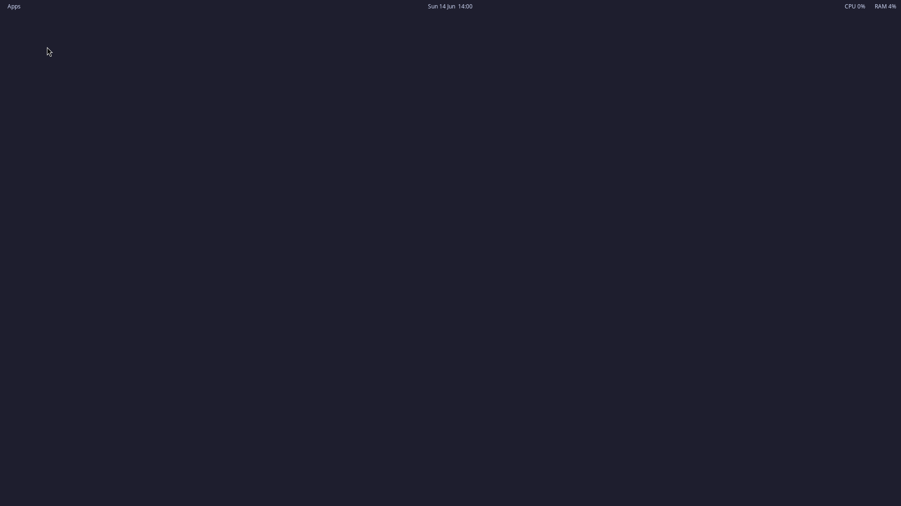

# Steam-Headless: CachyOS + Wayland edition

[](https://hub.docker.com/r/andyxtreme/steam-headless-cachyos)
[](https://ko-fi.com/andyxtreme)

A self-hosted **cloud-gaming desktop in a container**, rebuilt on **CachyOS**
with a **Wayland** session (labwc / wlroots) instead of the classic X11 + XFCE
stack. Run games on a headless server's NVIDIA GPU and play them from anywhere
in the browser or via Moonlight.

This is a Wayland fork of the excellent
[Steam-Headless/docker-steam-headless](https://github.com/Steam-Headless/docker-steam-headless)
by josh5 — see [Credits & license](#credits--license).



---

## Features

- 🖥️ **Wayland desktop** (labwc / wlroots) running fully **headless** (no monitor)
- 🌐 **Browser access** via noVNC — just open a URL, no client needed
- 🎮 **Moonlight streaming** via built-in **Sunshine** (low latency, NVENC)
- 🚀 **CachyOS gaming stack**: Steam, Heroic, Lutris, ProtonUp-Qt, Proton-CachyOS,
  gamescope, MangoHud, GameMode, Vulkan + 32-bit libs
- 🎛️ **Fully configurable** through a single `.env` file — nothing personal is
  baked into the image
- 🔊 Audio, keyboard, mouse and controller over both noVNC and Moonlight

## Requirements

- A Linux host (developed and tested on **TrueNAS Scale 25.10**) with an **NVIDIA GPU**
- **NVIDIA Container Toolkit / GPU passthrough** enabled, so `nvidia-smi` works
  inside containers
- **Docker + Docker Compose**
- ⚠️ **`nvidia-drm.modeset=1` on the host** — mandatory for Wayland on NVIDIA.
  Verify with `cat /sys/module/nvidia_drm/parameters/modeset` (must print `Y`);
  setup instructions are in [docs/nvidia-wayland.md](docs/nvidia-wayland.md).

---

## Quick start

### 1. Get the image

The prebuilt image is on Docker Hub as
[andyxtreme/steam-headless-cachyos](https://hub.docker.com/r/andyxtreme/steam-headless-cachyos);
`docker compose up -d` pulls it automatically:

```bash
docker pull andyxtreme/steam-headless-cachyos:latest
```

To build it yourself instead: the build context is the repository root (it
needs `overlay/` and `overlay-wayland/`), so build from a Linux box with Docker:

```bash
docker build -t andyxtreme/steam-headless-cachyos:latest .
```

> The first build is large (gaming stack + Proton). To move the image to another
> host: `docker save -o sh.tar andyxtreme/steam-headless-cachyos:latest`, copy it over, then
> `docker load -i sh.tar`. (Don't pipe `docker save` through `gzip` in Windows
> PowerShell - the pipe corrupts binary data.)

### 2. Configure

```bash
cp .env.example .env
nano .env
```

Required values — the compose refuses to start without them:

| Variable                | What                            | How to find it                 |
| ----------------------- | ------------------------------- | ------------------------------ |
| `USER_PASSWORD`         | Desktop (noVNC) password        | choose one                     |
| `SUNSHINE_PASS`         | Sunshine / Moonlight password   | choose one                     |
| `GPU_UUID`              | Your NVIDIA GPU                 | `nvidia-smi -L`                |
| `NVIDIA_DRIVER_VERSION` | Host driver version             | `nvidia-smi`                   |
| `DATA_DIR`              | Host folder for persistent data | e.g. `/mnt/pool/steam-headless`|

Common optional knobs: `DISPLAY_SIZEW` / `DISPLAY_SIZEH` / `DISPLAY_REFRESH`
(match your Moonlight resolution), `XKB_DEFAULT_LAYOUT` (e.g. `de`),
`PORT_NOVNC_WEB`, `TZ`, `PUID` / `PGID`, `MEM_LIMIT`. See
[`.env.example`](.env.example) for the annotated full list.

### 3. Deploy

```bash
docker compose up -d
```

The first start downloads the matching NVIDIA driver and bootstraps Steam — give
it a few minutes. It also creates `home/`, `games/`, `x11/` and `pulse/` under
`DATA_DIR`.

> On TrueNAS Scale you can also paste the compose into **Apps → Custom App →
> Install via YAML**, but the `.env` route via the shell keeps secrets out of the
> UI and its exports.

---

## Connecting

### Browser (noVNC)

Open `http://<host-ip>:31100/` → the labwc desktop appears and Steam
auto-starts. Right-click the wallpaper for the app menu (Steam / Heroic /
Lutris / Terminal).

### Moonlight

1. In Moonlight, add the host **by its IP** and start pairing → it shows a
   **PIN**. (Auto-discovery needs the host's D-Bus/Avahi, which the container
   deliberately doesn't use - `HOST_DBUS=false`.)
2. Enter that PIN in the Sunshine web UI at `https://<host-ip>:47990/`
   (log in with `SUNSHINE_USER` / `SUNSHINE_PASS`).

If pairing fails with "check the PIN", see
[docs/troubleshooting.md](docs/troubleshooting.md#moonlight-pairing-fails-with-check-the-pin).

---

## Documentation

| Document                                         | Contents                                                          |
| ------------------------------------------------ | ----------------------------------------------------------------- |
| [docs/architecture.md](docs/architecture.md)     | What changed vs. upstream, runtime layout, the Wayland overlay     |
| [docs/nvidia-wayland.md](docs/nvidia-wayland.md) | `nvidia-drm.modeset`, renderer settings, driver + NVENC pitfalls   |
| [docs/troubleshooting.md](docs/troubleshooting.md)| Logs, symptom table, Moonlight pairing, tuning                     |

## Repository layout

```
.
├── Dockerfile                # the CachyOS + Wayland image
├── docker-compose.yml        # deployment, fully driven by .env
├── .env.example              # copy to .env and edit
├── overlay/                  # upstream overlay, vendored unchanged
├── overlay-wayland/          # this fork's Wayland layer, copied over overlay/
└── docs/
```

---

## Support

If this edition helps you, I'd appreciate a small donation – thank you! ☕

[](https://ko-fi.com/andyxtreme)

## Credits & license

Built on top of
[Steam-Headless/docker-steam-headless](https://github.com/Steam-Headless/docker-steam-headless)
by **josh5** — the `overlay/` init system and entrypoint come from there and are
vendored unchanged.

Also thanks to [CachyOS](https://cachyos.org/),
[LizardByte / Sunshine](https://github.com/LizardByte/Sunshine),
[Moonlight](https://moonlight-stream.org/),
[labwc](https://github.com/labwc/labwc),
[wlroots](https://gitlab.freedesktop.org/wlroots/wlroots) and
[wayvnc](https://github.com/any1/wayvnc).

Licensed under **GPL-2.0**, same as upstream — see [LICENSE](LICENSE).
